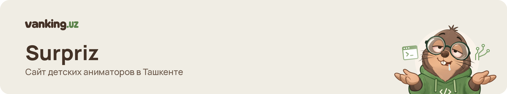
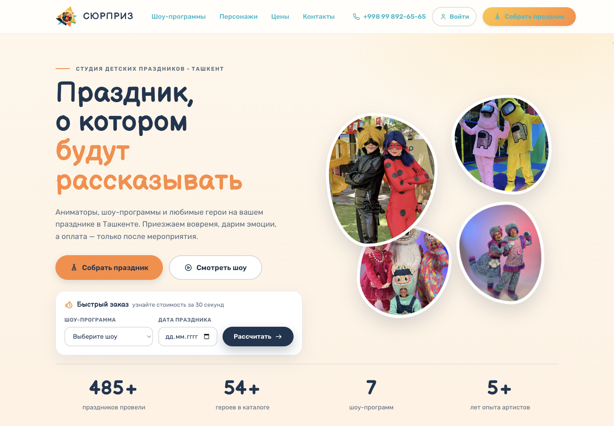

<picture>
  <source media="(prefers-color-scheme: dark)" srcset=".github/assets/banner-dark.png">
  
</picture>

**Surpriz** — сайт студии детских праздников в Ташкенте: клиент выбирает шоу и персонажей, собирает праздник и оформляет заказ, а команда ведёт каталог и заказы в админке.




## Что умеет

- Каталог персонажей и шоу-программ с категориями, тегами и умным поиском.
- Сборщик праздника: программа, персонажи, доп. услуги и бонус на выбор, дата и время с проверкой занятости, адрес на Яндекс Карте с проверкой зоны Ташкента.
- Вход и регистрация по коду из Telegram Gateway; черновик заказа сохраняется до входа.
- Личный кабинет клиента: история и статусы заказов.
- Админка: персонажи, шоу-программы, доп. услуги, заказы, клиенты, медиа и обложки (Flask и новое Next.js-приложение с Flask-адаптером).
- Telegram-уведомления команде о новых заказах с кнопками действий.

## Структура

| Путь | Что внутри |
|---|---|
| `app.py` | Точка входа Flask (`gunicorn app:app`) |
| `core/` | Модули сайта: загрузка страниц, каталог, заказы, кабинет, админка, Telegram |
| `templates/` | Jinja-шаблоны: `site/` — публичные страницы, `admin/` — админка |
| `static/` | CSS, JS, шрифты, медиа; `static/wp-content`, `static/wp-includes` — зеркало прежнего WordPress-сайта |
| `surpriz/` | Фронтенд лендинга (главная, каталог, шоу-программы) и его ассеты |
| `webapp/` | Next.js-приложение (публичные страницы и админка) и Flask-адаптер `webapp/adapter/` |
| `scripts/` | Служебные скрипты обслуживания каталога и данных |
| `tests/` | Тесты Flask-приложения |
| `deploy/` | Конфигурация nginx и systemd текущего релиза |
| `docs/` | Документация |
| `content` | Симлинк на данные продакшена (`/opt/surpriz/content`): страницы, SQLite, геоданные. В репозитории данных нет |

## Быстрый старт

Нужны Python 3 и, для `webapp/`, Node.js 22 с pnpm 10.

```bash
python3 -m venv .venv
.venv/bin/pip install -r requirements.txt
cp .env.example .env   # заполнить значения
.venv/bin/python app.py   # http://127.0.0.1:5000
```

- При пустой базе админов обязательны `SURPRIZ_ADMIN_USERNAME` и `SURPRIZ_ADMIN_PASSWORD`.
- `content` указывает на каталог продакшена. Для локального запуска направьте симлинк на свою копию данных (её не коммитить); минимум — `geo/tashkent-city-polygon.json`, каталоги `routes/character/`, `routes/errors/404/` и `data/admin/`.
- Ключи Яндекс Карт и токены Telegram необязательны: без них отключаются подсказки адреса и отправка кодов. Все переменные описаны в `.env.example` и `webapp/.env.example`.

Next.js-приложение:

```bash
cd webapp
cp .env.example .env.local   # при необходимости
pnpm install --frozen-lockfile
pnpm dev
```

## Тесты

```bash
.venv/bin/pip install pytest
.venv/bin/python -m pytest tests surpriz/tests webapp/adapter

cd webapp && pnpm lint && pnpm typecheck && pnpm test && pnpm build
```

Часть Python-тестов требует данных продакшена в `content/` и соседнего репозитория `surprizopus` с исходным каталогом; без них они падают.

## Стек

| Часть | Технологии |
|---|---|
| Сайт | Python 3, Flask 3, Jinja2, gunicorn, Flask-Compress |
| Новое приложение | Next.js 16, React 19, TypeScript, Tailwind CSS 4, Vitest, Playwright |
| Хранилище | SQLite (WAL) |
| Интеграции | Telegram Bot API, Telegram Gateway, Яндекс Карты |
| Инфраструктура | nginx, Let's Encrypt, systemd, Ubuntu |

## Деплой

Сайт работает на VPS: nginx принимает HTTPS и проксирует запросы на gunicorn (Flask), Flask-адаптер и Next.js; Telegram-бот работает отдельным systemd-сервисом. Каждый релиз выкладывается в отдельный каталог, общие данные и SQLite живут вне релизов. Порядок релиза и отката — в [docs/Deployment.md](docs/Deployment.md), конфигурация — в `deploy/`. Секреты хранятся только в `.env` на сервере.

## Документация

Оглавление — [docs/README.md](docs/README.md): продукт и бизнес-правила, каталог, сборщик заказа, кабинет, админка, Telegram, архитектура, дизайн-система, деплой.

## Лицензия

Лицензия пока не выбрана.

## English summary

Surpriz is the website of a children's party studio in Tashkent. Customers browse characters and show programs, build a party (program, characters, add-ons, date and time, address on Yandex Maps), sign in with a Telegram Gateway code and place an order; the team manages the catalog and orders in the admin panel and gets Telegram notifications. The stack is Flask with SQLite plus a Next.js 16 app with a small Flask adapter, served by nginx and systemd on a VPS. No license has been chosen yet.

---

<sub>Сделано в <a href="https://vanking.uz">vanking.uz</a> · Telegram <a href="https://t.me/vanking_bot">@vanking_bot</a></sub>
